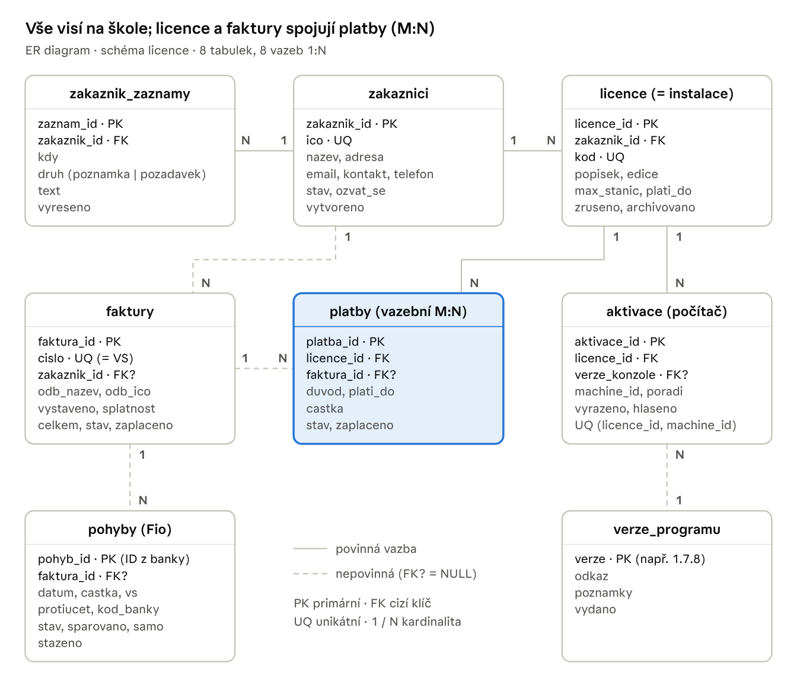

# Evidence licencí a plateb softwaru pro školy

## 1. Nápad a popis systému

Dělám software pro školy, který se prodává jako roční licence, a každá instalace potřebuje svoji vlastní. Program se při spuštění ozve na server, ověří si licenci a nahlásí, v jaké verzi běží. Jenže jak přibývají školy, začínám ztrácet přehled, komu licence končí, kdo už zaplatil a kdo ne a co po mně která škola chce. Problém, který chci vyřešit, je, aby to bylo vše na jednom místě v databázi.

Databáze mi má hlavně pohlídat, abych školám včas napsal, že jim licence končí, a nestalo se, že jim program jednoho dne prostě přestane fungovat. Druhá věc jsou platby: stahují se z banky a samy se spárují s fakturou podle variabilního symbolu, takže hned vidím, kdo zaplatil, a všimnu si i toho, kdo zadal špatný VS. Používat ji budeme my jako provozovatelé přes webovou administraci a zapisovat do ní budou automaticky i samotné instalace ve školách.

Databáze bude obsahovat školy a jejich kontakty, licence, počítače, na kterých jsou aktivované, a vydané verze programu. K tomu poznámky a požadavky od škol, faktury a platby z banky. Databáze mi má umožnit vydávat a prodlužovat licence, fakturovat, párovat platby a jedním dotazem zjistit, komu brzy končí licence a co s ním ještě musím vyřešit.

## 2. Uživatelé a přínosy

- **Provozovatel softwaru** (já a společník) zakládá školy, vydává a prodlužuje licence, vystavuje faktury, páruje platby a eviduje požadavky škol.
- **Instalace programu ve škole** se při aktivaci a pravidelném prodlužování licence automaticky hlásí a zapisuje svou verzi do tabulky `aktivace`.
- **Stahování z banky** automaticky ukládá příchozí platby do tabulky `pohyby` a páruje je s fakturami.

Konkrétním přínosem je, že provozovatel nemusí před telefonátem se školou dohledávat informace na pěti místech. Jedním dotazem získá seznam škol, kterým končí licence, i s dluhem, zastaralými instalacemi a otevřenými požadavky. Párování plateb podle VS navíc odhalí platby, které přišly se špatným symbolem.

## 3. Od požadavků k databázovému modelu

| Požadavek | Návrh v databázi |
|---|---|
| Evidovat školy a jejich kontaktní osoby | `zakaznici` |
| Evidovat licence pro jednotlivé instalace, jejich kód, edici a konec platnosti | `licence`, každá licence patří jedné škole |
| Vědět, na kterých počítačích je licence aktivovaná a jakou verzi hlásí | `aktivace`, vyměněný počítač se jen označí `vyrazeno` |
| Evidovat vydané verze programu | `verze_programu`, na kterou odkazuje `aktivace.verze_konzole` |
| Zapisovat poznámky a požadavky škol | `zakaznik_zaznamy` |
| Vědět, co se má za kterou licenci a období zaplatit | `platby`, spojovací tabulka mezi licencemi a fakturami |
| Vystavovat faktury | `faktury`, odběratel je na faktuře zkopírovaný |
| Ukládat platby z banky a párovat je s fakturami | `pohyby` |
| Zjistit dluh školy | Agregační `SELECT` nad fakturami po splatnosti; dluh se neukládá jako ručně měněná hodnota |

Model má **8 tabulek**. Jedna licence se za roky objeví na více fakturách (každé prodloužení je nová faktura) a jedna faktura obsahuje více licencí. Tento vztah mnoho-k-mnoha realizuje tabulka `platby`, která navíc nese vlastní údaje: za jaké období se platí, kolik a v jakém je to stavu.

### ER diagram

Soubor [`licence.dbml`](licence.dbml) obsahuje diagram, který lze vložit do editoru [dbdiagram.io](https://dbdiagram.io/). Snímek schématu je v souboru [`schema.png`](schema.png). Hlavní vztahy jsou:

```text
zakaznici 1 ── N licence 1 ── N aktivace N ── 1 verze_programu
zakaznici 1 ── N zakaznik_zaznamy
licence 1 ── N platby N ── 1 faktury   (M:N licence ↔ faktury)
zakaznici 1 ── N faktury 1 ── N pohyby
```



### Popis tabulek

| Tabulka | Účel a důležité údaje |
|---|---|
| `zakaznici` | Školy: název, IČO, adresa, e-mail, kontaktní osoba a telefon, obchodní stav (zájemce, zkouší, platí, odchází) a připomínka, kdy se ozvat. |
| `licence` | Licence pro jednu instalaci programu: licenční kód `RSTR-XXXX-XXXX-XXXX`, označení instalace, edice, maximální počet počítačů a konec platnosti. Zrušené nebo archivované licence se nemažou. |
| `aktivace` | Počítač, na kterém je licence aktivovaná: otisk počítače, pořadí aktivace, kdy se program naposledy ozval a jakou verzi hlásí. Vyměněný počítač dostane `vyrazeno`; kombinace licence a počítače je jedinečná. |
| `verze_programu` | Vydané verze programu, odkaz na instalátor, poznámky a datum vydání. Klíčem je přímo číslo verze. |
| `zakaznik_zaznamy` | Karta školy: poznámky a požadavky. Vyřešit (`vyreseno`) jde jen požadavek. |
| `platby` | Předpis platby za konkrétní licenci a období: důvod (založení, prodloužení), do kdy licenci prodlužuje, částka, stav a faktura, na které je. |
| `faktury` | Vystavené faktury: číslo (zároveň VS), kopie odběratele, popis, data vystavení a splatnosti, celková částka a stav (vystavená, zaplacená, stornovaná). |
| `pohyby` | Příchozí platby stažené z banky: ID pohybu z banky, datum, částka, VS a protiúčet. Spárovaný pohyb odkazuje na fakturu. |

## 4. Pravidla a zvolená zjednodušení

- Model je zjednodušenou verzí skutečného backendu v PostgreSQL. Názvy tabulek a sloupců zůstaly, ostrý systém ale používá UUID klíče; v projektu jsou kvůli čitelnosti celočíselné klíče `*_id` jako ve vzoru.
- Částky faktur a předpisů jsou v celých korunách (`integer`), protože ceny licencí i služeb jsou celé koruny. Pohyby z banky mají `numeric(12,2)`, protože platba může přijít s haléři. Typ `float` se nepoužívá.
- Provozovatel je neplátce DPH, faktura proto nese jen celkovou částku. Položky faktury, číselná řada faktur ani generování PDF nejsou součástí modelu.
- Licence odpovídá jedné instalaci programu. Samostatná tabulka instalací by byla zbytečná, protože vztah instalace–licence je 1:1 a označení instalace je jen `popisek` licence.
- Prodloužení licence posune `plati_do`, kód licence se nemění (je zadaný v nainstalovaném programu). Historie jednotlivých období zůstává v tabulce `platby`.
- Vyměněný počítač se nemaže, dostane `vyrazeno`; licence se nemažou, ale archivují (`archivovano`). Historie tak zůstává.
- Faktura, předpis platby i pohyb mají uložený sloupec `stav`, protože jde o rozhodnutí (storno, ruční úhrada, pohyb „nepatří“), které z jiných dat spočítat nejde. Aby si stav neodporoval s ostatními sloupci, hlídají ho `CHECK` omezení přes více sloupců, např. `(stav = 'zaplacena') = (zaplaceno IS NOT NULL)`.
- Dluh školy, aktuální verze programu ani počet otevřených požadavků se neukládají. Počítají se dotazem, aby nevznikly zastaralé hodnoty.
- Na faktuře je zkopírovaný název a IČO odběratele. Je to záměrná redundance: daňový doklad se nesmí změnit, když se škola přejmenuje nebo smaže. Proto má `faktury.zakaznik_id` pravidlo `ON DELETE SET NULL`.
- Pohyb z banky má `vs` (jak přišel z banky, může být chybný) i `faktura_id` (výsledek párování). Nejde o duplicitu, každý sloupec říká něco jiného.
- Předpis platby by měl patřit licenci stejné školy, jaké je faktura. Pravidlo se týká více tabulek, takže ho běžný `CHECK` nevynutí; v ostrém systému ho hlídá funkce, která faktury vystavuje (v pokročilejší verzi by šel použít trigger).
- Unikátní omezení brání duplicitnímu IČO, licenčnímu kódu, číslu faktury i opakované aktivaci stejného počítače na stejné licenci. ID pohybu z banky je primární klíč, takže opakované stažení výpisu nic nezdvojí.
- `CHECK` omezení hlídají formáty (licenční kód, IČO, číslo faktury, verze, otisk počítače), výčty stavů a logiku dat (splatnost po vystavení, kladné částky).
- Indexy jsou na cizích klíčích, přes které se spojuje (`licence.zakaznik_id`, `aktivace.licence_id`, `zakaznik_zaznamy.zakaznik_id`, `faktury.zakaznik_id`, `platby.licence_id`, `platby.faktura_id`, `pohyby.faktura_id`).

## 5. Ukázková data a dotaz

Skript [`licence.sql`](licence.sql) vytvoří schéma `licence` a všech osm tabulek. Vzorová data jsou v [`licence.seed.sql`](licence.seed.sql): čtyři školy, devět licencí, deset aktivací, čtyři verze, pět záznamů, osm faktur, jedenáct předpisů plateb a sedm pohybů z banky. Data odpovídají příběhovému zadání. Datumy jsou relativní k `CURRENT_DATE`, takže dotaz dává stejný výsledek v kterýkoliv den, kdy se databáze vytvoří.

Ukázkový dotaz odpovídá na otázku: **Komu mám volat kvůli obnově licence a co s ním musím vyřešit?** Je v souboru [`vzorovy_select.sql`](vzorovy_select.sql) a spojuje tabulky `zakaznici`, `licence`, `aktivace`, `verze_programu`, `faktury` a `zakaznik_zaznamy`. Každou část počítá v samostatné agregaci (CTE), aby se spojením více licencí, počítačů a faktur neznásobily počty a částky.

Výsledek nad vzorovými daty:

| skola | kontakt | koncicich_licenci | zbyva_dni | na_stare_verzi | dluh_kc | otevrene_pozadavky |
|---|---|---|---|---|---|---|
| ZŠ Lipová, Ostrava | Petr Novák | 3 | 25 | 2 | 1800 | 2 |
| Gymnázium Na Kopci, Opava | Martin Svoboda | 2 | 40 | 0 | 0 | 0 |
| ZŠ Pod Lesem, Frýdek-Místek | Lucie Procházková | 2 | 55 | 1 | 2400 | 1 |

SPŠ Havířov ve výsledku není, protože jí licence končí až za 200 dní. Gymnázium má v datech i starý počítač na verzi 1.6.0, ale ten je vyřazený, takže se nepočítá. Dluh ZŠ Lipová 1 800 Kč je faktura, kterou škola zaplatila se špatným VS: v tabulce `pohyby` leží nespárovaný pohyb na stejnou částku. Pro jiné období změňte hodnotu `dni` v CTE `obdobi`.

